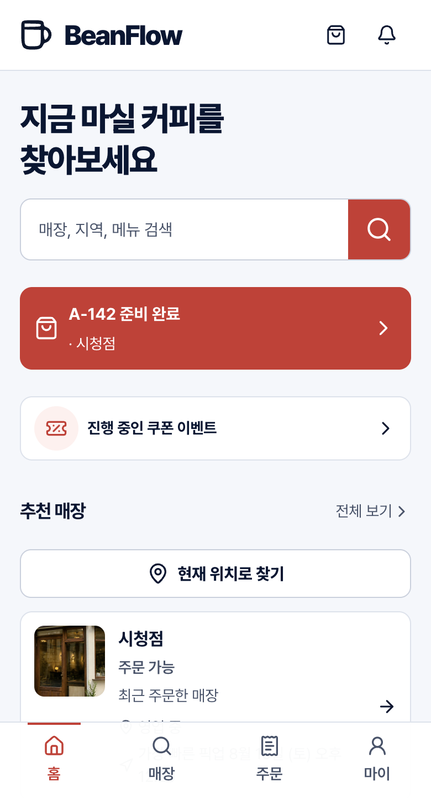
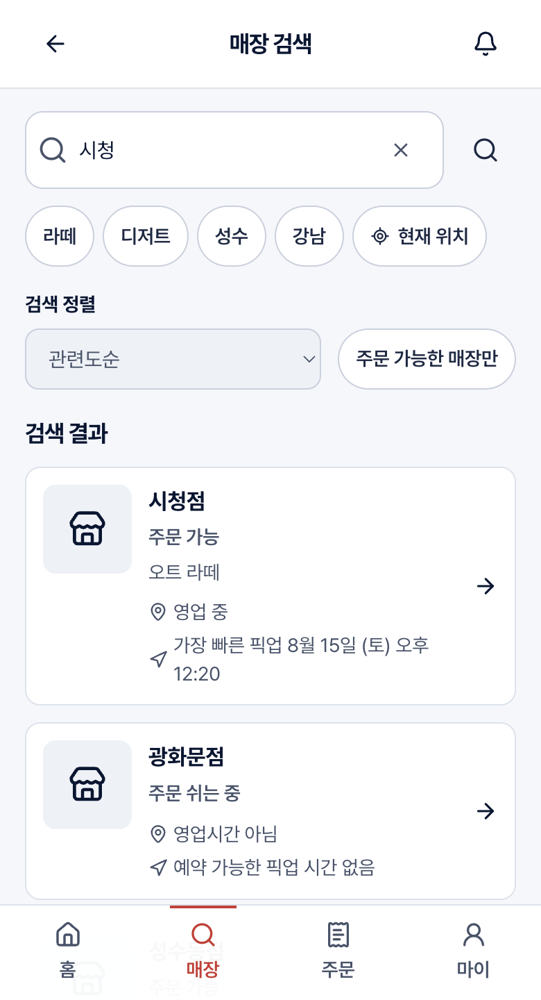
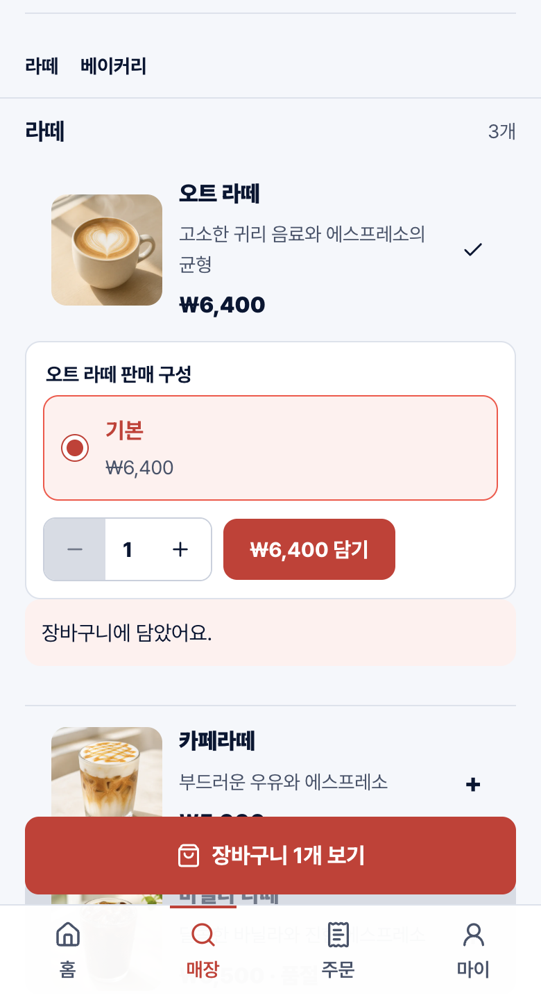
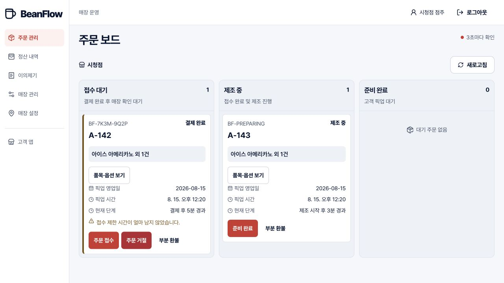
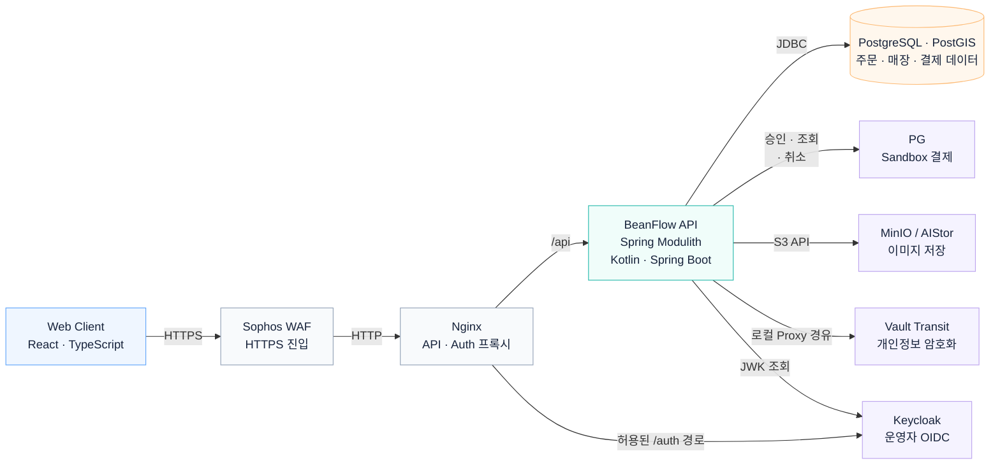

<div align="center">

# BeanFlow

**고객 주문과 결제부터 매장 픽업, 포인트 적립과 정산까지 지원하는 카페 주문 플랫폼 | 개인 프로젝트**

**Kotlin · Java 21 · Spring Boot · Spring Modulith · JPA · PostgreSQL · React/TypeScript**

[대표 구현](#highlights) · [화면 둘러보기](#screens) · [아키텍처](#architecture) · [실행 방법](#run-and-test) · [문서](#documents)

</div>

<a id="highlights"></a>

## 대표 구현·개선

| 주제 | 해결한 문제와 결과 | 근거 |
| --- | --- | --- |
| [**CI 실행시간 최적화**](#ci-optimization) | 1,334개 테스트 유지, **26분 08초 → 15분 26초** | [PR #90](https://github.com/kdh949/BeanFlow/pull/90) |
| [**이벤트 목록 N+1 개선**](#event-list-batch-read) | 이벤트 100개 조회 시 **SQL 101회 → 2회** | [PR #200](https://github.com/kdh949/BeanFlow/pull/200) |
| [**결제 조회 병목 개선**](#payment-query-index) | 대상 SQL 평균 **11.754ms → 0.0227ms** | [측정 기록](docs/quality/payment-idempotency-result-apply-index-evidence.md) |
| [**중복 결제·응답 유실 처리**](#payment-recovery) | 동일 요청 결과 재사용, 결과 불명 결제는 PG 조회로 확인 | [설계·테스트](docs/adr/ADR-007-payment-idempotency-reconciliation.md) |

CI 시간은 GitHub Actions 각 3회 중앙값, 결제 SQL 시간은 개인 스테이징 측정값입니다. 이벤트 SQL 횟수는 PostgreSQL Testcontainers에서 검증했습니다.

**추가 개선:** [픽업번호 반복 집계 제거](#pickup-counter) · [감사 기록 SELECT 제거](#audit-append) · [예약형 주문의 견적 충돌 수정](#quote-stability)

<a id="screens"></a>

## 화면 둘러보기

| 고객 홈 | 매장 검색 | 메뉴 선택 |
| --- | --- | --- |
|  |  |  |

고객은 홈에서 주문 상태를 확인하고, 매장을 찾아 메뉴와 수량을 선택해 장바구니에 담습니다.

<details>
<summary><strong>매장 주문 보드 보기 — 접수·제조·픽업 관리</strong></summary>



매장 주문 보드에서 들어온 주문을 수락하거나 거절하고, 제조 중·준비 완료 상태를 관리합니다.

</details>

## 주요 기능

고객이 주문하고 결제하면 매장에서 접수·제조·픽업을 관리합니다. 결제 응답이 끊긴 주문의 상태 조회, 매장 거절이나 고객 취소 후 환불과 쿠폰·포인트 반환까지 구현했습니다.

**매장·메뉴 선택 → 주문·결제 → 매장 접수·제조 → 픽업 → 포인트 적립·정산**

- **계정·인증:** 고객 회원가입·로그인·로그아웃, 점주 계정 로그인과 첫 비밀번호 변경을 지원합니다. 고객과 점주는 각각 세션 쿠키를 사용합니다.
- **고객 주문:** 주문 당시 메뉴·옵션·가격·할인 내역을 저장하고, 쿠폰·포인트를 적용해 주문합니다.
- **결제:** Toss Payments 테스트 환경 연동, 중복 승인 방지, 승인 결과 조회, 결제 취소를 구현했습니다.
- **매장 처리:** 주문 수락·거절·제조·완료 상태를 관리합니다. 매장 거절 시 환불과 쿠폰·포인트 반환을 처리합니다.
- **포인트·정산:** 포인트 적립·사용, 부분 환불 금액 배분, 정산 내역과 조정 기록을 관리합니다.
- **사용자 화면:** 고객 앱, 매장·운영 콘솔과 별도의 방문자 주문 체험 화면을 제공합니다.

## 대표 구현 상세

<a id="ci-optimization"></a>

### CI 실행시간 최적화

- 필수 CI 완료까지 약 26분이 걸려 실행 로그를 분석했습니다. 테스트 실행 그룹마다 소요시간 차이가 컸고, 클래스마다 PostGIS 컨테이너를 다시 시작하는 비용도 확인했습니다.
- 전체 테스트를 유지하고 실행시간이 긴 클래스부터 6개 runner에 분배했습니다. PostGIS 컨테이너는 JVM별로 공유하고 DB는 클래스별로 격리했습니다.
- **1,334개 테스트를 유지하면서 필수 CI 완료시간을 26분 08초 → 15분 26초로 41% 단축**했습니다. GitHub Actions 각 3회 측정 중앙값이며, runner-minute 중앙값은 병렬화 비용으로 30% 증가했습니다.

[구현 PR #90](https://github.com/kdh949/BeanFlow/pull/90) · [실행시간·비용 측정 기록](docs/exec-plans/completed/ci-full-suite-optimization.md) · [CI workflow](.github/workflows/ci.yml)

<a id="event-list-batch-read"></a>

### 이벤트 목록 N+1 개선

- 이벤트마다 매장 정보를 개별 조회하면서, 이벤트 100개를 반환하는 API 요청 한 번에 SQL이 101회 실행되는 문제를 발견했습니다.
- 이벤트 모듈이 매장 엔티티에 직접 의존하지 않도록 매장 모듈의 조회 인터페이스를 확장했습니다. 목록의 매장 ID에서 중복을 제거하고, 필요한 표시 정보를 한 번에 조회해 각 이벤트에 연결했습니다.
- PR #200의 PostgreSQL 통합 테스트에서 **이벤트 100개 조회 시 SQL 101회 → 2회**를 확인했습니다. 개인 스테이징의 100 VU·30초 실행에서는 HTTP p95가 **2.17초 → 995.58ms**로 측정됐습니다.

측정 조건: 변경 후 HTTP 값은 JVM 예열 뒤 결과입니다. 초기 실행의 실패와 50 VU에서 지연이 증가한 결과도 아래 PR에 함께 기록했습니다.

[조회 개선과 측정 조건](docs/quality/customer-event-store-batch-read.md) · [구현·전후 측정 PR #200](https://github.com/kdh949/BeanFlow/pull/200) · [매장 조회 인터페이스](src/main/kotlin/io/github/kdh949/beanflow/merchant/api/StoreDisplaySnapshotOperations.kt) · [이벤트 목록 통합 테스트](src/test/kotlin/io/github/kdh949/beanflow/promotion/internal/CustomerEventCampaignControllerTest.kt)

<a id="payment-query-index"></a>

### 결제 멱등성 조회의 전체 스캔 제거

- 결제 결과를 반영할 때 멱등성 기록을 `payment_id`로 조회하지만 해당 인덱스가 없어, 전체 테이블을 반복해서 읽는 `Seq Scan`이 발생했습니다.
- 결제 처리와 멱등성 검증을 유지하면서 조회 비용을 줄이도록 `payment_id` 인덱스를 추가했습니다. PostgreSQL 25,000행 테스트에서 `Index Scan` 전환과 SQL 실행시간 **3.465ms → 1.081ms**를 확인했습니다.
- 같은 이미지·DB·Toss 테스트 드라이버로 **80 VU·초당 주문 시나리오 12회·3분**을 비교한 결과, 대상 SQL 평균 실행시간은 **11.754ms → 0.0227ms**, 누적 실행시간은 **25.849초 → 0.0492초**였습니다. 전체 HTTP p95는 216.42ms → 230.81ms로 측정됐습니다.

[구현 PR #198](https://github.com/kdh949/BeanFlow/pull/198) · [실행계획·스테이징 A/B 측정](docs/quality/payment-idempotency-result-apply-index-evidence.md) · [Flyway V92 인덱스](src/main/resources/db/migration/V92__index_payment_idempotency_by_payment.sql) · [인덱스·실행계획 테스트](src/test/kotlin/io/github/kdh949/beanflow/payment/internal/PaymentIdempotencyQueryMigrationTest.kt)

<a id="payment-recovery"></a>

### 중복 결제·응답 유실과 주문 만료 처리

- PG 응답 지연이나 유실 뒤 승인 요청을 다시 보내면 중복 결제가 발생할 수 있어, 멱등성 키·요청 해시·DB 유일 제약으로 요청을 구분하고 동일 요청에는 저장된 상태와 결과를 반환합니다.
- PG 응답을 기다리는 동안 DB 커넥션과 락을 오래 점유하지 않도록 호출 전후의 DB 트랜잭션을 분리했습니다. 결제 결과를 알 수 없으면 `UNKNOWN`으로 저장하고 PG 조회로 확인하며, 끝내 확정되지 않으면 `MANUAL_REVIEW`로 남깁니다.
- PG 승인 후 DB 저장이 실패하면 주문 상태를 다시 확인해 이미 결제 완료된 주문과 만료된 주문을 구분합니다. 만료 뒤 발견된 승인은 취소·환불로 연결하고, 환불·쿠폰·포인트 반환·알림은 작업별 상태를 저장해 실패한 작업을 재처리하도록 구현했습니다. 지연 승인과 중복 처리 경로는 PostgreSQL 통합 테스트로 검증했습니다.

[구현 PR #8](https://github.com/kdh949/BeanFlow/pull/8) · [결제 승인·복구 통합 테스트](src/test/kotlin/io/github/kdh949/beanflow/ordering/internal/PaymentConfirmationIntegrationTest.kt) · [트랜잭션 분리 · ADR-006](docs/adr/ADR-006-external-payment-transaction-boundary.md) · [멱등성·승인 결과 조회 · ADR-007](docs/adr/ADR-007-payment-idempotency-reconciliation.md)

<a id="pickup-counter"></a>

### 픽업번호 발급 시 반복 집계 제거

- 카운터를 처음 만들 때 기존 번호와 겹치지 않도록 과거 주문 수와 최대 번호를 확인하던 집계가, 카운터가 이미 있어도 매 주문마다 반복되는 문제를 발견했습니다.
- 카운터가 마지막 발급 번호를 관리하고 주문 저장 실패 시 번호 증가도 취소되므로, 과거 집계는 카운터 생성 시에만 수행하고 이후에는 마지막 번호에 1을 더하도록 변경했습니다.
- 같은 DB·매장·영업일에서 기존 SQL과 변경 SQL을 번갈아 실행한 결과, **발급 SQL 실행시간이 4.834ms → 0.036ms**로 줄었습니다. 첫 실행을 제외한 4회 중앙값이며, 동시 최초 발급 시 번호 유일성과 주문 실패 시 롤백도 통합 테스트로 검증했습니다.

[구현 PR #135](https://github.com/kdh949/BeanFlow/pull/135) · [SQL 측정 기록](docs/quality/performance-pickup-counter-2026-09-08.md) · [픽업번호 설계 · ADR-097](docs/adr/ADR-097-store-pickup-number.md)

<a id="audit-append"></a>

### JPA 감사 기록 저장 시 불필요한 SELECT 제거

- 새 감사 기록에 UUID를 미리 부여하면서 JPA가 `merge`로 처리해, INSERT 전에 같은 ID의 기록이 있는지 확인하는 SELECT가 매번 실행되는 문제를 발견했습니다.
- 감사 기록은 기존 내용을 수정하지 않고 새로 추가만 하므로, 존재 확인 없이 INSERT하는 `persist` 전용 저장 경로로 변경하고 중복 기록이 포함된 배치는 전체 롤백하도록 유지했습니다.
- **감사 기록 3건 추가에 따른 SQL 실행 횟수 6회 → 3회**를 Hibernate Statistics로 확인하고, SQL 횟수와 중복 배치의 전체 롤백을 회귀 테스트로 검증했습니다.

[구현 PR #137](https://github.com/kdh949/BeanFlow/pull/137) · [SQL 검증 기록](docs/quality/performance-audit-append-2026-09-08.md) · [감사 기록 회귀 테스트](src/test/kotlin/io/github/kdh949/beanflow/operations/internal/AuditRecordTest.kt)

<a id="quote-stability"></a>

### 예약형 주문의 견적 충돌 수정

- 예약형 주문에서 슬롯 사용량과 version까지 견적 fingerprint에 포함해, 다른 고객이 예약하면 자리가 남아 있어도 기존 견적으로 주문할 수 없는 문제가 있었습니다.
- 가격·메뉴·픽업 시간처럼 고객이 확인할 거래 조건과 주문 시점의 잔여량 검사를 분리했습니다. 슬롯 사용량은 견적 비교에서 제외하고, 최종 주문 트랜잭션에서 row lock을 잡고 현재 잔여 수량을 확인하도록 했습니다.
- 개인 스테이징의 같은 초당 5개 주문 시나리오 조건에서 **견적 충돌 37/450건 → 0/450건**을 확인했습니다. 마지막 한 자리에는 한 주문만 성공하는지도 별도 동시성 테스트로 검증했습니다. 이 기록은 예약형 주문의 수정 당시 측정이며, 현재 신규 주문은 픽업 슬롯을 예약하지 않는 즉시 주문 방식입니다.

[수정·부하 재측정 기록](docs/quality/performance-quote-stability-retest-2026-09-08.md) · [검증 분리 · ADR-123](docs/adr/ADR-123-order-quote-trade-terms-and-shared-availability.md) · [주문 동시성 테스트](src/test/kotlin/io/github/kdh949/beanflow/ordering/internal/CreateOrderConcurrencyTest.kt)

<a id="architecture"></a>
<a id="아키텍처"></a>

## 아키텍처와 주요 설계

주문·결제·포인트·정산 코드는 Spring Modulith로 나누고 하나의 애플리케이션으로 실행합니다. 모듈 사이에서는 공개 API와 이벤트를 사용하며, 의존성은 구조 테스트로 검증합니다.



고객·점주·운영 화면의 요청은 WAF와 Nginx를 거쳐 BeanFlow API로 전달됩니다. 거래·위치 정보는 PostgreSQL·PostGIS에, 이미지는 객체 저장소에 보관합니다. 고객·점주는 세션으로 로그인하고 운영자는 Keycloak을 사용합니다.

[전체 구조](docs/architecture/overview.md) · [결제 승인과 결과 조회](docs/architecture/payment.md) · [주문 접수부터 픽업·정산까지](docs/architecture/order.md) · [주문 취소·환불과 정산 조정](docs/architecture/refund.md)

### 주문 가격과 정산 내역 보존

주문을 마친 뒤 매장에서 메뉴 가격이나 옵션을 수정할 수 있습니다. 주문 항목에는 당시 상품명·옵션·단가·할인 배분을 함께 저장해, 이후 가격 변경이 과거 환불·정산 금액에 영향을 주지 않도록 했습니다.

확정된 정산 내역도 그대로 보존합니다. 이후 환불이나 이의제기로 금액이 바뀌면 별도의 정산 조정 내역에 기록합니다.

**관련 코드**

- [주문 가격 스냅샷 · ADR-004](docs/adr/ADR-004-order-price-snapshot.md)
- [정산 조정 내역 · ADR-008](docs/adr/ADR-008-settlement-adjustment-ledger.md)
- [모듈 의존성 테스트](src/test/kotlin/io/github/kdh949/beanflow/architecture/ModularityTests.kt)

[아키텍처 개요](docs/architecture/architecture-overview.md) · [설계 결정](docs/architecture/decision-summary.md) · [Runtime OpenAPI](openapi/beanflow-v1-runtime.yaml)

<a id="run-and-test"></a>

## 실행과 테스트

**로컬 실행**

Java 21, Node.js/npm, Docker와 `curl`, Python 3, `lsof`, `ps`가 필요합니다. 아래 스크립트는 로컬 PostgreSQL/PostGIS, 데모 인증 서버, API와 프런트엔드를 기동하고 테스트 데이터를 준비합니다.

```bash
bash scripts/demo/start.sh
bash scripts/demo/seed.sh
```

기동 로그에 표시된 주소에서 고객 앱(`/app`), 매장 콘솔(`/store`), 운영 콘솔(`/ops`)을 엽니다. 로컬 결제에는 scripted adapter를 사용합니다.

- Smoke test: `bash scripts/demo/smoke.sh`
- 종료: `bash scripts/demo/stop.sh`
- [로컬 실행 문서](docs/operations/local-demo-runbook.md)

**테스트**

PostgreSQL 통합 테스트는 Docker와 Testcontainers를 사용합니다.

```bash
./gradlew test
./gradlew build --stacktrace
```

**일반 로그인**

고객은 `/app/signup`에서 회원가입하고 `/app/login`에서 로그인합니다. 점주는 발급받은 계정으로 `/store/login`에 접속한 뒤, 첫 로그인 때 `/store/password`에서 비밀번호를 변경합니다.

- [고객 회원가입·로그인 API](src/main/kotlin/io/github/kdh949/beanflow/identity/internal/CustomerAccountController.kt)
- [점주 로그인·비밀번호 변경 API](src/main/kotlin/io/github/kdh949/beanflow/identity/internal/MerchantAccountController.kt)

**방문자 데모**

`/demo`에서는 방문자용 고객·점주 계정과 샘플 매장을 이용해 주문부터 픽업까지 체험할 수 있습니다. `local,local-demo` 또는 `local,toss-sandbox` 설정에서 기능을 켭니다. 실행 방법은 [방문자 데모 문서](docs/operations/visitor-demo-runbook.md)에 정리했습니다.

<a id="documents"></a>

## 문서

- [전체 기능 목록](docs/architecture/capability-map.md)
- [아키텍처와 주요 설계](docs/architecture/decision-summary.md)
- [주문·결제·환불의 실패 처리](docs/architecture/failure-semantics.md)
- [Runtime OpenAPI](openapi/beanflow-v1-runtime.yaml)
- [테스트 구성](docs/testing/test-strategy.md)
