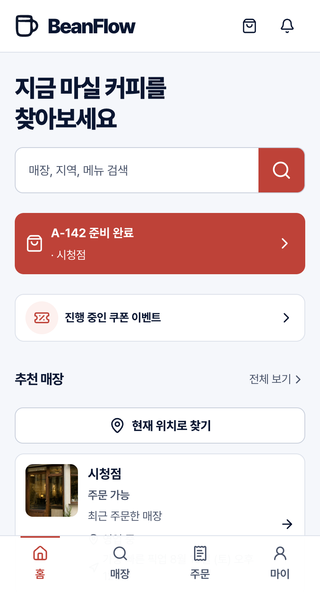
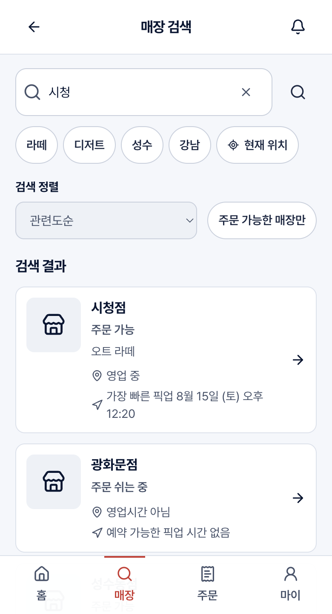
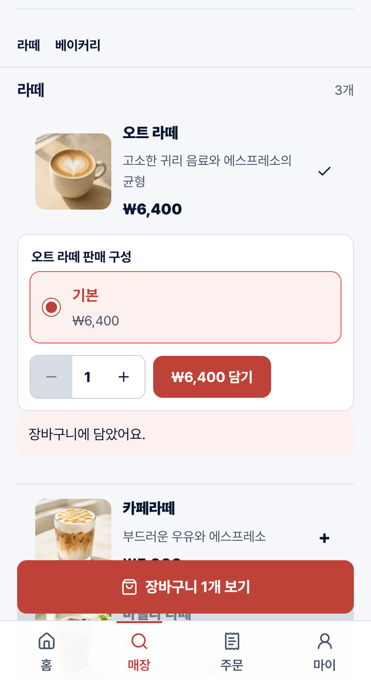
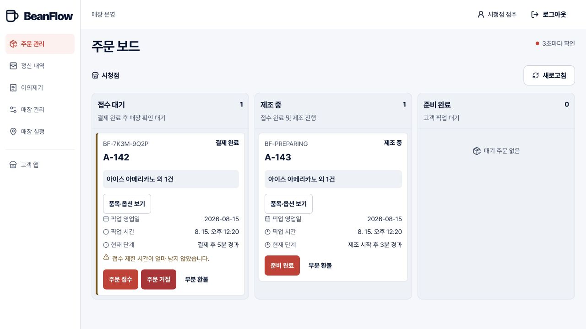
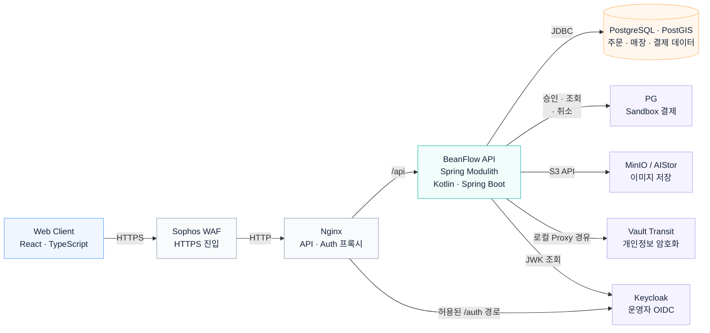

# BeanFlow

**카페 주문·결제·픽업·포인트·환불·정산 플랫폼 | 개인 프로젝트**

고객이 주문하고 결제하면 매장에서 접수·제조·픽업을 관리합니다. 결제 응답이 끊긴 주문의 상태 조회, 매장 거절이나 고객 취소 후 환불과 쿠폰·포인트 반환까지 구현했습니다.

**Kotlin · Java 21 · Spring Boot · Spring Modulith · JPA · PostgreSQL · React/TypeScript**

[데모 실행 방법](docs/operations/visitor-demo-runbook.md) · [아키텍처](#아키텍처) · [설계 결정](docs/architecture/decision-summary.md) · [OpenAPI](openapi/beanflow-v1-runtime.yaml)

## 화면 둘러보기

| 고객 홈 | 매장 검색 | 메뉴 선택 |
| --- | --- | --- |
|  |  |  |

고객은 홈에서 주문 상태를 확인하고, 매장을 찾아 메뉴와 수량을 선택해 장바구니에 담습니다.



매장 주문 보드에서 들어온 주문을 수락하거나 거절하고, 제조 중·준비 완료 상태를 관리합니다.

## 주요 기능

- **계정·인증:** 고객 회원가입·로그인·로그아웃, 점주 계정 로그인과 첫 비밀번호 변경을 지원합니다. 고객과 점주는 각각 세션 쿠키를 사용합니다.
- **고객 주문:** 주문 당시 메뉴·옵션·가격·할인 내역을 저장하고, 쿠폰·포인트를 적용해 주문합니다.
- **결제:** Toss Payments 테스트 환경 연동, 중복 승인 방지, 승인 결과 조회, 결제 취소를 구현했습니다.
- **매장 처리:** 주문 수락·거절·제조·완료 상태를 관리합니다. 매장 거절 시 환불과 쿠폰·포인트 반환을 처리합니다.
- **포인트·정산:** 포인트 적립·사용, 부분 환불 금액 배분, 정산 내역과 조정 기록을 관리합니다.
- **사용자 화면:** 고객 앱, 매장·운영 콘솔과 별도의 방문자 주문 체험 화면을 제공합니다.

## 아키텍처



고객·점주·운영 화면의 요청은 WAF와 Nginx를 거쳐 BeanFlow API로 전달됩니다. 거래·위치 정보는 PostgreSQL·PostGIS에, 이미지는 객체 저장소에 보관합니다. 고객·점주는 세션으로 로그인하고 운영자는 Keycloak을 사용합니다.

[전체 구조](docs/architecture/overview.md) · [결제 승인과 결과 조회](docs/architecture/payment.md) · [주문 접수부터 픽업·정산까지](docs/architecture/order.md) · [주문 취소·환불과 정산 조정](docs/architecture/refund.md)

## 1. 결제 응답 유실과 중복 승인 처리

PG 승인 요청이 timeout으로 끝나면 결제 성공 여부를 바로 알 수 없습니다. DB 작업을 PG 호출 전후의 두 트랜잭션으로 나누고, 재요청에는 저장된 처리 결과를 반환하도록 구현했습니다.

1. 첫 DB 트랜잭션에 결제 요청과 멱등성 정보를 저장합니다.
2. 트랜잭션을 종료한 뒤 PG 승인 API를 호출합니다.
3. 승인 응답을 받으면 두 번째 트랜잭션에서 주문과 결제 상태를 갱신합니다.
4. 응답이 끊기면 `UNKNOWN`으로 기록하고 PG 조회 API로 승인 상태를 조회합니다.

같은 멱등성 키로 요청이 다시 들어오면 저장된 상태와 결과를 반환합니다. `UNKNOWN` 상태는 PG 승인 내역을 조회해 갱신하고, 결과가 끝내 확정되지 않으면 `MANUAL_REVIEW`로 남깁니다.

매장 거절이나 고객 취소로 발생한 환불·쿠폰·포인트 반환·알림은 작업별 처리 상태를 저장합니다. 실패한 작업만 다시 실행할 수 있습니다.

**관련 코드**

- [결제 승인 통합 테스트](src/test/kotlin/io/github/kdh949/beanflow/ordering/internal/PaymentConfirmationIntegrationTest.kt)
- [PG 호출 전후 트랜잭션 분리 · ADR-006](docs/adr/ADR-006-external-payment-transaction-boundary.md)
- [멱등성·승인 결과 조회 · ADR-007](docs/adr/ADR-007-payment-idempotency-reconciliation.md)

## 2. 결제 멱등성 조회 인덱스 추가

결제 결과를 반영할 때 `payment_idempotency_record` 테이블을 `payment_id`로 조회합니다. 기존에는 `payment_id` 인덱스가 없어 해당 조회에 `Seq Scan`이 사용됐습니다.

PostgreSQL에 25,000행의 테스트 데이터를 넣고 실행계획을 비교한 뒤 `payment_id` 인덱스를 추가했습니다.

- **변경 전:** `Seq Scan`, 3.465ms
- **변경 후:** `Index Scan`, 1.081ms

스테이징에서는 Toss 테스트 드라이버로 **80 VU·초당 주문 시나리오 12회·3분**을 실행했습니다. 인덱스 적용 전후 대상 SQL 누적 실행시간은 **25.849초 → 0.0492초**였습니다.

같은 테스트에서 전체 HTTP p95는 **216.42ms → 230.81ms**였습니다.

**관련 코드**

- [실행계획과 스테이징 A/B 측정 기록](docs/quality/payment-idempotency-result-apply-index-evidence.md)
- [인덱스 개선 PR #198](https://github.com/kdh949/BeanFlow/pull/198)
- [Flyway V92 인덱스](src/main/resources/db/migration/V92__index_payment_idempotency_by_payment.sql)
- [인덱스·실행계획 테스트](src/test/kotlin/io/github/kdh949/beanflow/payment/internal/PaymentIdempotencyQueryMigrationTest.kt)

## 3. 주문 가격과 정산 내역 보존

주문을 마친 뒤 매장에서 메뉴 가격이나 옵션을 수정할 수 있습니다. 주문 항목에는 당시 상품명·옵션·단가·할인 배분을 함께 저장해, 이후 가격 변경이 과거 환불·정산 금액에 영향을 주지 않도록 했습니다.

확정된 정산 내역도 그대로 보존합니다. 이후 환불이나 이의제기로 금액이 바뀌면 별도의 정산 조정 내역에 기록합니다.

주문·결제·포인트·정산 코드는 Spring Modulith로 나눴고, 모듈 사이에서는 공개 API와 이벤트를 사용합니다.

**관련 코드**

- [주문 가격 스냅샷 · ADR-004](docs/adr/ADR-004-order-price-snapshot.md)
- [정산 조정 내역 · ADR-008](docs/adr/ADR-008-settlement-adjustment-ledger.md)
- [모듈 의존성 테스트](src/test/kotlin/io/github/kdh949/beanflow/architecture/ModularityTests.kt)

## 실행과 테스트

**로컬 실행**

Java 21, Node.js/npm, Docker와 `curl`, Python 3, `lsof`, `ps`가 필요합니다. 아래 스크립트는 로컬 PostgreSQL/PostGIS, 데모 인증 서버, API와 프런트엔드를 기동하고 테스트 데이터를 준비합니다.

```bash
bash scripts/demo/start.sh
bash scripts/demo/seed.sh
```

기동 로그에 표시된 주소에서 고객 앱(`/app`), 매장 콘솔(`/store`), 운영 콘솔(`/ops`)을 엽니다. 로컬 결제에는 scripted adapter를 사용합니다.

- Smoke test: `bash scripts/demo/smoke.sh`
- 종료: `bash scripts/demo/stop.sh`
- [로컬 실행 문서](docs/operations/local-demo-runbook.md)

**테스트**

PostgreSQL 통합 테스트는 Docker와 Testcontainers를 사용합니다.

```bash
./gradlew test
./gradlew build --stacktrace
```

**일반 로그인**

고객은 `/app/signup`에서 회원가입하고 `/app/login`에서 로그인합니다. 점주는 발급받은 계정으로 `/store/login`에 접속한 뒤, 첫 로그인 때 `/store/password`에서 비밀번호를 변경합니다.

- [고객 회원가입·로그인 API](src/main/kotlin/io/github/kdh949/beanflow/identity/internal/CustomerAccountController.kt)
- [점주 로그인·비밀번호 변경 API](src/main/kotlin/io/github/kdh949/beanflow/identity/internal/MerchantAccountController.kt)

**방문자 데모**

`/demo`에서는 방문자용 고객·점주 계정과 샘플 매장을 이용해 주문부터 픽업까지 체험할 수 있습니다. `local,local-demo` 또는 `local,toss-sandbox` 설정에서 기능을 켭니다. 실행 방법은 [방문자 데모 문서](docs/operations/visitor-demo-runbook.md)에 정리했습니다.

## 문서

- [전체 기능 목록](docs/architecture/capability-map.md)
- [아키텍처와 주요 설계](docs/architecture/decision-summary.md)
- [주문·결제·환불의 실패 처리](docs/architecture/failure-semantics.md)
- [Runtime OpenAPI](openapi/beanflow-v1-runtime.yaml)
- [테스트 구성](docs/testing/test-strategy.md)
