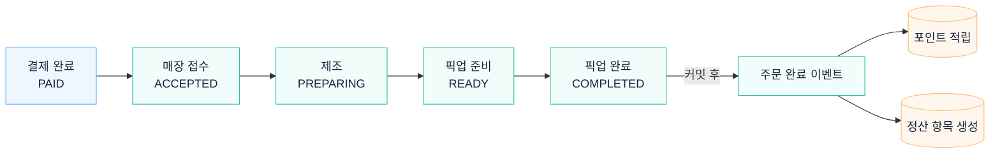

# 주문 접수부터 픽업·정산까지

매장이 결제된 주문을 접수하면 제조·준비 완료·픽업 순서로 진행합니다. 주문 완료 이벤트는 포인트 적립과 정산 항목 생성으로 연결됩니다.

## 관련 문서

- [주문 가격 스냅샷 · ADR-004](../adr/ADR-004-order-price-snapshot.md)
- [정산 조정 내역 · ADR-008](../adr/ADR-008-settlement-adjustment-ledger.md)

[시스템 구조](overview.md) · [README](../../README.md#아키텍처)
