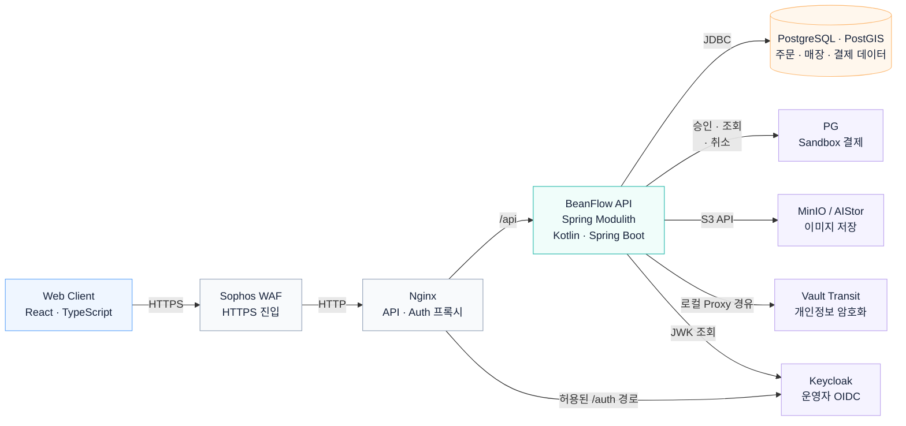

# BeanFlow 시스템 아키텍처

고객·점주·운영 화면의 요청은 WAF와 Nginx를 거쳐 BeanFlow API로 전달됩니다. 거래·위치 정보는 PostgreSQL·PostGIS에, 이미지는 객체 저장소에 보관합니다. 고객·점주는 세션으로 로그인하고 운영자는 Keycloak을 사용합니다.

## 기능별 흐름

- [결제 승인과 결과 조회](payment.md)
- [주문 접수부터 픽업·정산까지](order.md)
- [주문 취소·환불과 정산 조정](refund.md)

## 관련 문서

- [모듈 구성과 데이터 책임](architecture-overview.md)
- [주요 설계 결정](decision-summary.md)

[README](../../README.md#아키텍처)
