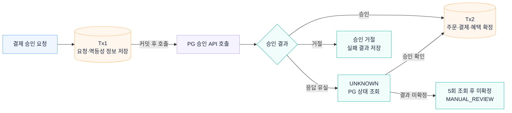

# 결제 승인과 결과 조회

결제 요청을 먼저 저장하고 PG를 호출한 뒤 승인 결과를 별도 트랜잭션에 반영합니다. 응답이 끊기면 `UNKNOWN`으로 기록하고 PG에서 승인 상태를 조회합니다.

## 관련 문서

- [PG 호출 전후 트랜잭션 분리 · ADR-006](../adr/ADR-006-external-payment-transaction-boundary.md)
- [멱등성과 승인 결과 조회 · ADR-007](../adr/ADR-007-payment-idempotency-reconciliation.md)

[시스템 구조](overview.md) · [README](../../README.md#아키텍처)
