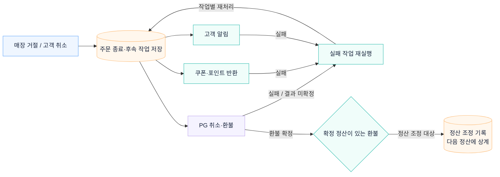

# 주문 취소·환불과 정산 조정

매장 거절이나 고객 취소 후 환불·쿠폰·포인트 반환 작업의 처리 상태를 저장합니다. 실패한 작업은 다시 실행하고, 확정 정산에 반영할 변경은 조정 내역으로 남깁니다.

## 관련 문서

- [주문·결제·환불의 실패 처리](failure-semantics.md)
- [정산 조정 내역 · ADR-008](../adr/ADR-008-settlement-adjustment-ledger.md)

[시스템 구조](overview.md) · [README](../../README.md#아키텍처)
