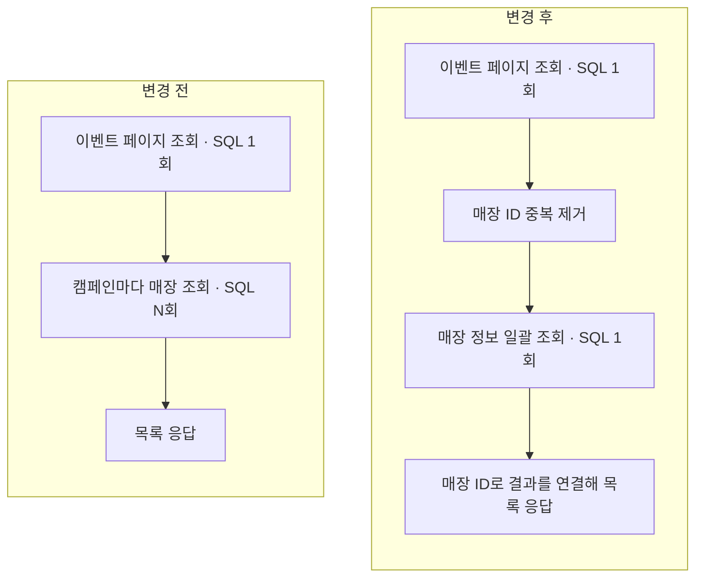

# 고객 이벤트 목록의 매장 조회 일괄화

고객 이벤트 목록은 각 캠페인에 매장 이름과 표시 정보를 붙여 반환합니다. 캠페인마다 매장을 조회하던 코드를, 페이지의 매장 ID를 모아 한 번에 조회하는 방식으로 바꿨습니다.

## 조회 흐름

Promotion은 Merchant의 공개 조회 API를 호출하고, Merchant가 매장 ID 집합으로 표시 정보를 조회합니다. 요청한 매장 정보가 빠졌거나 유효하지 않으면 `503`을 반환합니다.

## SQL 실행 횟수

PostgreSQL Testcontainers 통합 테스트에서 `GET /api/v1/me/events?limit=100`의 목록 조회 SQL 실행 횟수를 비교했습니다.

| 페이지 조건                         | 변경 전 | 변경 후 |
| ----------------------------------- | ------: | ------: |
| 이벤트 1개                          |     2회 |     2회 |
| 이벤트 100개 · 서로 다른 매장 100개 |   101회 |     2회 |

변경 후 테스트에는 빈 페이지 1회, 같은 매장의 이벤트 100개를 조회할 때 2회인 경우도 포함했습니다.

## 구현과 측정 기록

- [고객 이벤트 목록 API](../../src/main/kotlin/io/github/kdh949/beanflow/promotion/internal/CustomerEventCampaignController.kt)
- [Merchant 공개 조회 API](../../src/main/kotlin/io/github/kdh949/beanflow/merchant/api/StoreDisplaySnapshotOperations.kt)
- [매장 표시 정보 일괄 조회](../../src/main/kotlin/io/github/kdh949/beanflow/merchant/internal/StoreDisplaySnapshotService.kt)
- [SQL 실행 횟수 통합 테스트](../../src/test/kotlin/io/github/kdh949/beanflow/promotion/internal/CustomerEventCampaignControllerTest.kt)
- [변경 전후 측정 기록](../exec-plans/active/customer-event-store-batch-read.md)
- [구현 PR #200](https://github.com/kdh949/BeanFlow/pull/200)

[README](../../README.md)
