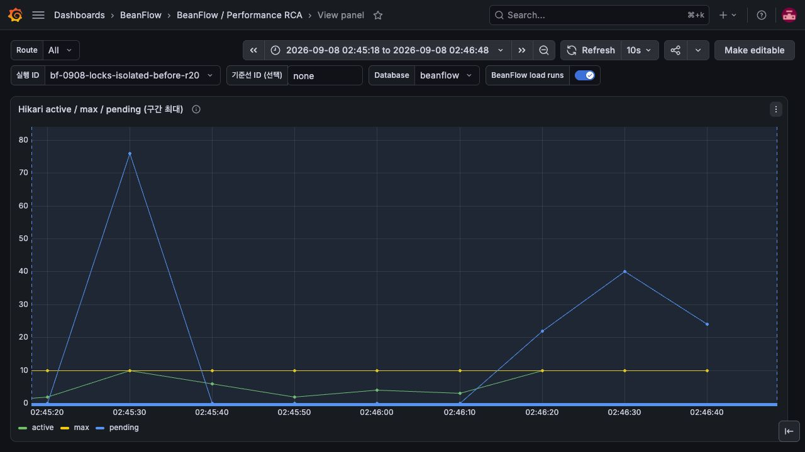
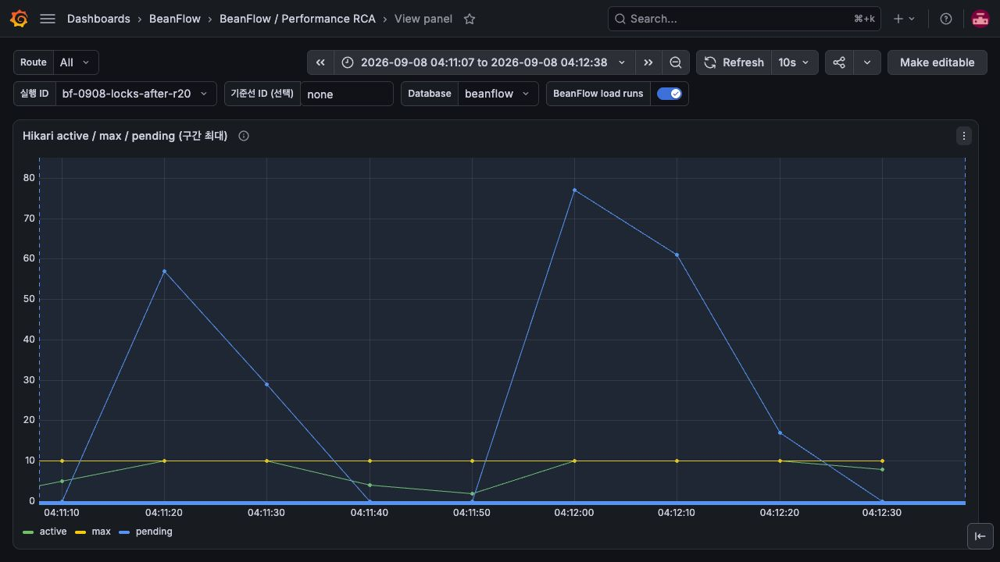

# 감사 기록 append 전용 persist 경로 검증

## 변경 근거와 동작

새 감사 기록을 저장할 때마다 INSERT 전에 존재 확인 SELECT가 실행됐다. UUID를 미리 부여한
엔티티가 merge 경로로 처리되는 것이 원인이었다.

감사 기록은 추가만 하므로 AuditRecordService가 만든 새 엔티티를
`AuditRecordAppendRepository`의 persist/flush로 저장하도록 바꿨다. `@Repository`의 예외 변환과
`@Transactional(MANDATORY)`를 통한 호출자 트랜잭션 참여는 유지했다. 조회 repository도 그대로 둔다.
별도 Spring configuration으로 실행하는 operator/ordinary-policy bootstrap에도 writer를 import했다.
이 import가 빠져 시작에 실패하던 문제를 같은 PR에서 수정했다.

## 개별 수정의 검증

감사 기록 3건을 추가할 때 늘어난 SQL 실행 횟수는 **6개 → 3개**였다. Hibernate statistics로
INSERT 전에 실행되던 존재 확인 SELECT가 사라진 것을 확인했다. 이 SQL 횟수 테스트는 기존 구현에서 실패했다.
새 저장 경로, 중복 배치의 전체 롤백, 개인정보 원문 거부, 보존 기간과 두 bootstrap의 실제 저장도 검증했다.
main 기반 분리 worktree에서 **30개 테스트 및 bootJar 통과**, failure/error/skipped 0.
통합 회귀 테스트 110개와 추가 bootstrap/audit 테스트 23개는 실행 범위가 겹친다. 각 실행의 결과를 별도로 기록했다.

[Spring Data JPA의 entity 상태 판별 계약](https://docs.spring.io/spring-data/jpa/reference/jpa/entity-persistence.html)에
따라 수동 UUID가 있는 새 append를 일반 save/merge 경로로 보내지 않도록 했다.

```bash
./gradlew --no-daemon -Pkotlin.incremental=false test --tests '*AuditRecordTest' --tests '*AuditRetentionPolicyIntegrationTest' --tests '*OperatorPermissionBootstrapApplicationTest' --tests '*OrdinaryPointAccrualPolicyBootstrapApplicationTest' --tests '*OperatorPermissionIntegrationTest' --tests '*OrdinaryPointAccrualPolicyBootstrapTest' bootJar
```

## 실제 배포와 통합 부하 결과

통합 revision `686ba07885ac0f7fece39da6a3569208c6bf1094`를 배포했다. 이미지 digest는
`sha256:46f2167d5885596cf358bd1e962e6d22edc13660415ffedd5e1f8d7cffb2f576`이다.
[전체 CI](https://github.com/kdh949/BeanFlow/actions/runs/34151795027)와
[이미지 workflow](https://github.com/kdh949/BeanFlow/actions/runs/34151796891)가 통과했다.
분리 PR의 head CI와 통합 이미지 검증은 서로 다른 증거다.

같은 합성 고객 20명·매장/메뉴 각 1개·미래 픽업 슬롯 4개에서 수량 1,
쿠폰/포인트 없는 `toss-success`를 사용했다. HTTPS WAF를 통해 견적→주문→결제 시도→승인
4 HTTP 요청을 실행했다. API 2GiB, PostgreSQL 1.5GiB, Hikari 10, trace sampling 1.0,
wall profile 10ms와 load script를 고정했다. 로컬 Gradle 실행과 아래 부하는 겹치지 않았다.

| 실행 ID | 부하 | pre/max VU | 승인 | 미시작(dropped) | HTTP p95/p99(ms) | workflow p95(ms) |
|---|---|---|---:|---:|---:|---:|
| bf-0908-locks-before-r20 | 20/s,90s | 80/80 | 1659 | 142 | 1744.4 / 2575.5 | 6362.9 |
| bf-0908-locks-isolated-before-r20 | 20/s,90s | 80/80 | 1718 | 83 | 1338.6 / 2418.1 | 5625.8 |
| bf-0908-locks-after-r20 | 20/s,90s | 80/80 | 1698 | 102 | 1482.0 / 2424.1 | 5366.8 |
| bf-0908-locks-after-r20-repeat | 20/s,90s | 80/80 | 1648 | 152 | 1772.4 / 2812.5 | 6856.4 |

시작한 workflow의 실패율은 모두 0이었지만 목표 부하의 일부를 투입하지 못해 실행 판정은 FAILED였다.
수정 후 HTTP p95와 dropped는 기존 두 측정 사이에 있었고, 반복 실행은 직전 20/s 부하의 환불 처리와
겹쳐 더 나빠졌다. **통합 부하에서 전체 처리량과 HTTP 지연은 일관되게 개선되지 않았다.**

이 실행에서는 여러 SQL 수정과 환불 드라이버 변경을 함께 배포했다. 기존 UNKNOWN 환불 재시도
8270건이 MANUAL_REVIEW로 넘어갔고, 새 환불 성공에 따른 금융 event publication과 누적 DB 크기도
전후에 달랐다. `isolated` 실행에도 이전 테스트의 UNKNOWN 환불 재시도가 남아 있었다.
감사 저장 변경의 단독 효과는 앞의 SQL 횟수 테스트로 확인했다.

수정 후 본 실행의 Prometheus 표본 최대는 Hikari active 10/pending 77, DB ungranted lock 5,
호스트 CPU 85.8%, iowait 14.9%, API CPU 2.44 cores였다. Grafana를 브라우저로 확인했다.
대표 trace `ed587e1bae7562e6a80a1218b2db45e`에서 승인 요청 1582ms 중 pickup SELECT가 341ms였다.
repository span에는 SQL 실행과 커넥션 획득 등 여러 구간이 포함된다. 락·커넥션 풀 대기는 개별 SQL과 풀 지표를 함께 보고 판단한다.

2026-09-07 19:16:46 UTC read-only repeatable-read 확인에서 예열141·5/s301·20/s1698건의
native 생성/승인 수와 DB가 일치했다. 픽업 슬롯 counter 불일치, 정원 초과, 중복 픽업번호는 0이었다.
예열+5/s 442건은 환불/보상/정원 복구 SUCCEEDED였다. 본 실행의 비동기 환불은 당시 진행 중이었다.
환불 이후 정산·분석 금융 이벤트는 일부 미완료 상태여서 후속 처리가 남아 있었다.

부하 fixture SHA256: `e08f3fa7e965527e527b47326e82981b7c05b10d1a1d9c5d365a7611bf5daca9`.
script SHA256: `3f91175346682f67d0f2e2dfb73611b5550b5894665097a6bbf153692aa48301`.
raw fixture/토큰/개별 결제 내역은 공개하지 않는다. Grafana 캡처는 실제 저장된 해당 시각의 지표를
현재 패널로 조회한 것이다. 캡처는 이동 구간의 percentile을, 표는 실행 전체의 k6 최종 통계를 보여준다.

## 실패·한계와 롤백

append repository에 이미 존재하는 엔티티를 넘기면 중복 오류를 반환하고 호출자 트랜잭션을 롤백한다.

DB migration이나 공개 API 형태 변경은 없다. 이전 immutable 이미지와 설정 백업으로 되돌릴 수 있으나
perf driver 재시작 시 기존 결제 이력의 명시적 snapshot/restore 검증이 필요하다.

## Grafana 캡처

수정 전 (실제 패널의 시각과 축을 함께 확인):



수정 후 (실제 패널의 시각과 축을 함께 확인):



위 Hikari 패널은 통합 부하 중 커넥션 풀 상태를 보여준다. 감사 SELECT 횟수의 전용 지표는 없으며,
단독 SQL 감소량은 앞의 Hibernate statistics 테스트에서 측정했다.

## 캡처 파일의 CI 등록

PR에 추가한 PNG가 기존 저장소 안전성 테스트의 명시적 바이너리 목록에 없어 CI가 실패했다.
검토한 Grafana PNG 14개의 경로만 공통 목록에 등록하고, 다른 바이너리와 비밀 패턴 검사는 유지했다.
`LocalDemoRepositorySafetyTest` 5개 테스트를 로컬에서
통과시켰으며, 변경된 각 PR head의 전체 CI를 다시 실행한다.
